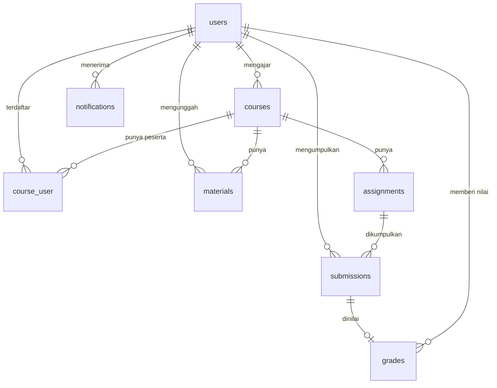

# AGENTS.md - Panduan Konteks, Arsitektur, dan Pemetaan Masalah KampusLMS

Dokumen ini adalah sumber kebenaran (source of truth) untuk asisten AI dan pengembang dalam memahami arsitektur, aturan domain, siklus 16 minggu, serta pemetaan file proyek **KampusLMS (Kelompok A07)**.
Ketika pengguna menanyakan suatu masalah atau meminta perbaikan fitur, gunakan indeks pemetaan masalah di dokumen ini untuk langsung menuju file terkait tanpa perlu memindai seluruh basis kode.

---

## 1. Identitas & Tujuan Proyek

- **Nama Proyek:** KampusLMS (LMS Ringan Berbasis Laravel 12)
- **Mata Kuliah:** SI2514024 - Pemrograman Web (Semester 5, Ganjil 2026/2027)
- **Model Pembelajaran:** Project-Based Learning (PBL), bertahap minggu 1 sampai 16.
- **Tujuan Utama:** Menghasilkan aplikasi LMS perkuliahan yang fungsional, aman (kebal IDOR, bebas path traversal, pemisahan storage privat), bebas dari masalah N+1 query, teruji otomatis, dan live di domain publik dengan HTTPS/SSL.
- **Stack Teknologi:**
  - Backend: Laravel 12.x, PHP 8.3+
  - Database: MySQL 8 / MariaDB 11
  - Frontend: Blade polos (Minggu 1-6) -> Opsi lanjut (Blade+Livewire / Inertia / SPA) setelah Minggu 6
  - Asset Bundler: Vite + Tailwind CSS
  - API: Laravel Sanctum (`/api/v1`), Bearer Token, Resource Response Wrapper
  - Queue: Driver database (`jobs` & `notifications`)
- **Prinsip Arsitektur:**
  - Controller tipis (skinny controller), Model kaya logika relasi (fat model), View terbebas dari query database (dumb view).
  - Konvensi modern Laravel 12: konfigurasi middleware dan exception terpusat di `bootstrap/app.php` (tidak lagi menggunakan `app/Http/Kernel.php`).

---

## 2. Roadmap Proyek 16 Minggu & Milestone

Setiap minggu pembelajaran memiliki 4 tahap terstruktur:
1. **READ:** Membaca dan menelusuri alur kode yang sudah bekerja.
2. **BREAK:** Eksperimen mandiri merusak kode untuk melihat pesan error dan dampaknya.
3. **FIX:** Memperbaiki bug pada branch latihan (`kampuslms-broken`) dan mengirim PR.
4. **BUILD:** Mengimplementasikan fitur riil ke repo proyek kelompok.

| Minggu | Topik & Fokus Utama | Deliverable & Milestone | Komponen Penilaian |
|---|---|---|---|
| **01** | Fondasi Web & Arsitektur MVC Laravel 12 | Setup repo GitHub, Git config, struktur direktori Laravel 12 | Kuis 1 (1%) + Checkpoint 1 (2%) |
| **02** | Routing, Controller & Blade Templating | Route RESTful, parsing parameter, layout Blade induk | Kuis 2 (1%) + Checkpoint 2 (2%) |
| **03** | Database, Migrasi, Seeder & Relasi Eloquent | Migrasi 7 tabel inti, foreign keys, seeder data realistis volume besar | **Milestone M1 (Tugas 1 - 3%)** + Rekaman Interview |
| **04** | State, Sesi, Flash Message & Form Request Validation | Validasi server-side, sanitasi input, session flash | Kuis 3 (1%) + Checkpoint 4 (2%) |
| **05** | Routing Lanjutan, Route Model Binding & Pencegahan IDOR | Otorisasi model binding, pencegahan manipulasi ID via URL | Kuis 4 (1%) + Checkpoint 5 (2%) |
| **06** | RESTful API, Sanctum Token & Gerbang Jalur Frontend | Endpoint `/api/v1`, bearer token Sanctum, unified JSON responses | Kuis 5 (1%) + Checkpoint 6 (2%) |
| **07** | Autentikasi, 3 Role (`admin`, `dosen`, `mahasiswa`), Middleware & Policy | Role-based access control, Gate & Policy per model, proteksi route | **Milestone M2 (Tugas 2 - 3%)** + Rekaman Interview |
| **08** | **UTS: Demo Aplikasi & Code Walkthrough** | Live demo fitur F1-F6, walkthrough kode baris-per-baris | **UTS (20%)** |
| **09** | Penanganan & Penyimpanan Berkas Aman (Private Disk) | Upload berkas, validasi MIME magic bytes, anti-path traversal, storage privat | Kuis 6 (1%) + Checkpoint 9 (2%) |
| **10** | Pemrosesan Latar Belakang (Queue) & In-App Notification | Worker antrean, notifikasi tugas dan nilai via background job, idempotent grading | **Milestone M3 (Tugas 3 - 7%)** + Rekaman Interview |
| **11** | Optimasi Performa Database & Eliminasi N+1 Query | Eager loading `with()`, profiling query via Debugbar/Telescope, indexing | Kuis 7 (1%) + Checkpoint 11 (2%) |
| **12** | Deployment Domain Publik, HTTPS/SSL & Security Hardening | Live di VPS/cloud publik, SSL wildcard, seeder akun demo produksi | **Milestone M4 (Tugas 4 - 7%)** + Rekaman Interview |
| **13** | Kolaborasi Git, Version Control & Peer Review | Pull request review antar kelompok menggunakan checklist audit | Review Peer (10%) + Kuis 8 (1%) + Checkpoint 13 (2%) |
| **14** | Automated Testing (Feature & Unit Tests) | Test suite PHPUnit/Pest: uji otorisasi, upload, IDOR, dan alur API | Kuis 9 (1%) + Checkpoint 14 (2%) |
| **15** | Integrasi Proyek, Clean Code & Perapian Akhir | Refactoring kode, sanitasi git tree, dokumentasi deployment final | Kuis 10 (1%) + Checkpoint 15 (2%) |
| **16** | **UAS: Presentasi Proyek Akhir & Interview Individu** | Evaluasi proyek live final, uji integritas dan pemahaman kode individual | **Proyek Akhir / UAS (20%)** |

---

## 3. Skema Database, Relasi Eloquent, & Constraint Wajib

Skema database terdiri dari 7 tabel inti yang bersifat wajib dan seragam:

### Constraint & Index Kunci:
1. `course_user`: **Unique Composite** pada `('course_id', 'user_id')`. Mencegah mahasiswa terdaftar ganda di mata kuliah yang sama.
2. `submissions`: **Unique Composite** pada `('assignment_id', 'user_id')`. Satu mahasiswa hanya memiliki 1 baris submission aktif per tugas.
3. `grades`: **Unique** pada `submission_id`. Relasi one-to-one strictly enforced; pembaruan nilai wajib idempotent (`updateOrCreate`).
4. `courses`: `code` bersifat UNIQUE; foreign key `lecturer_id` merujuk ke `users.id` dengan aturan `restrictOnDelete`.
5. `materials` & `assignments`: Foreign key `course_id` menggunakan `cascadeOnDelete`.

### Peta Relasi Eloquent:
- **`User`** (`app/Models/User.php`):
  - `taughtCourses()` -> `hasMany(Course, 'lecturer_id')`
  - `courses()` -> `belongsToMany(Course)->withPivot('enrolled_at')->withTimestamps()`
  - `submissions()` -> `hasMany(Submission)`
  - `gradesGiven()` -> `hasMany(Grade, 'graded_by')`
- **`Course`** (`app/Models/Course.php`):
  - `lecturer()` -> `belongsTo(User, 'lecturer_id')`
  - `students()` -> `belongsToMany(User)->withPivot('enrolled_at')->withTimestamps()`
  - `materials()` -> `hasMany(Material)`
  - `assignments()` -> `hasMany(Assignment)`
- **`Assignment`** (`app/Models/Assignment.php`):
  - `course()` -> `belongsTo(Course)`
  - `submissions()` -> `hasMany(Submission)`
  - `grades()` -> `hasManyThrough(Grade, Submission)`
- **`Submission`** (`app/Models/Submission.php`):
  - `assignment()` -> `belongsTo(Assignment)`
  - `student()` -> `belongsTo(User, 'user_id')`
  - `grade()` -> `hasOne(Grade)`
- **`Grade`** (`app/Models/Grade.php`):
  - `submission()` -> `belongsTo(Submission)`
  - `grader()` -> `belongsTo(User, 'graded_by')`
- **`Material`** (`app/Models/Material.php`):
  - `course()` -> `belongsTo(Course)`
  - `uploader()` -> `belongsTo(User, 'uploaded_by')`

---

## 4. Matriks Peran, Otorisasi, & Aturan Keamanan (Anti-Bocor)

Terdapat 3 peran (role) dalam sistem: `admin`, `dosen`, dan `mahasiswa`.

| Fitur / Aksi | Admin | Dosen | Mahasiswa |
|---|:---:|:---:|:---:|
| CRUD Pengguna & Tetapkan Role | Ya | Tidak | Tidak |
| CRUD Mata Kuliah | Ya | Tidak | Tidak |
| Kelola Enrollment Mahasiswa | Ya | Ya (MK sendiri) | Tidak |
| Unggah & Kelola Materi | Ya | Ya (MK sendiri) | Hanya Lihat / Unduh |
| Buat & Kelola Tugas | Ya | Ya (MK sendiri) | Hanya Lihat |
| Pengumpulan Tugas (Submit) | Tidak | Tidak | Ya (MK terdaftar) |
| Memberikan Nilai & Feedback | Tidak | Ya (MK sendiri) | Tidak |
| Melihat Nilai | Ya | Ya (MK sendiri) | Hanya Nilai Sendiri |

### Aturan Keamanan Wajib (Akan Ditanyakan Saat Interview & Tes):
1. **Pencegahan IDOR (Insecure Direct Object References):**
   - Mahasiswa dilarang melihat atau mengunduh submission milik mahasiswa lain, meskipun menebak ID via URL `/submissions/{id}` atau `/submissions/{id}/download`.
   - Otorisasi diwajibkan di level Controller menggunakan `Gate::authorize('view', $submission)` (pada `SubmissionPolicy`, otorisasi unduh/lihat dipusatkan pada method `view`).
   - Pada `SubmissionPolicy.php`: Mahasiswa hanya diizinkan jika `$user->id === $submission->user_id`. Dosen hanya diizinkan jika `$user->id === $submission->assignment->course->lecturer_id`. Admin diizinkan (`true`).
2. **Pemisahan Storage Privat (Anti Storage Leak):**
   - Seluruh berkas submission tugas dan materi kuliah WAJIB disimpan pada disk `local` (`storage/app/private/`), BUKAN di `storage/app/public/`.
   - Berkas di disk `local` tidak boleh dapat diakses langsung melalui URL publik server web (harus return 403 / 404).
   - Penyaluran berkas hanya boleh dilakukan melalui controller yang telah lolos otorisasi Gate (`return Storage::disk('local')->response(...)` untuk inline preview atau `->download(...)` untuk unduh).
3. **Pencegahan Path Traversal & Collision Berkas:**
   - Nama berkas fisik di disk wajib di-hash otomatis menggunakan SHA1 40-karakter unik bawaan Laravel (`$file->store('submissions')`).
   - Jangan pernah menggunakan nama asli berkas dari pengguna sebagai nama path fisik di disk. Simpan nama asli hanya di kolom database `original_name`.
   - Validasi berkas wajib memeriksa MIME type asli (magic bytes) menggunakan aturan `mimes:pdf,docx,zip` (jangan hanya mengandalkan ekstensi nama berkas string).
4. **Integritas Waktu Server:**
   - Status keterlambatan (`is_late`) dan waktu pengumpulan (`submitted_at`) dihitung mutlak oleh jam server (`now()->gt($assignment->due_at)`). Abaikan parameter waktu yang dikirim oleh client.
5. **Penilaian & Pengumpulan Idempotent:**
   - Pengumpulan ulang tugas (revisi) menggunakan `Submission::updateOrCreate(['assignment_id' => $assignment->id, 'user_id' => $user->id], [...])` dan otomatis membersihkan berkas lama di disk fisik.
   - Dosen yang mengubah nilai tugas memanggil endpoint yang mengeksekusi `Grade::updateOrCreate(['submission_id' => $submission->id], [...])` untuk menghindari tabrakan UNIQUE constraint pada `submission_id`.

---

## 5. Indeks Cepat: Pemetaan Masalah ke File & Komponen (Problem-to-File Routing)

Ketika pengguna bertanya mengenai masalah tertentu, langsung tuju file yang dipetakan di bawah ini:

| Gejala Masalah / Kebutuhan Fitur | File / Lokasi Target Utama | Baris / Fungsi / Tindakan yang Harus Diperiksa |
|---|---|---|
| **Login gagal, sesi terputus, atau role tidak dikenali** | - `routes/auth.php` - `app/Http/Controllers/Auth/` - `app/Models/User.php` - `bootstrap/app.php` | Periksa method login, pengecekan enum `role`, casting atribut, dan pendaftaran alias middleware role di `bootstrap/app.php`. |
| **IDOR / Mahasiswa bisa intip atau unduh tugas mahasiswa lain** | - `app/Policies/SubmissionPolicy.php` - `app/Http/Controllers/SubmissionController.php` | Pastikan controller memanggil `Gate::authorize('view', $submission)`. Di Policy, cocokkan `$user->id === $submission->user_id`. |
| **Dosen bisa mengakses mata kuliah atau nilai milik dosen lain** | - `app/Policies/CoursePolicy.php` - `app/Policies/AssignmentPolicy.php` - `app/Policies/GradePolicy.php` | Cocokkan apakah `$course->lecturer_id === $user->id` atau `$assignment->course->lecturer_id === $user->id`. |
| **File submission atau materi bocor / bisa dibuka langsung dari URL browser** | - `config/filesystems.php` - `app/Http/Controllers/SubmissionController.php` - `app/Http/Controllers/MaterialController.php` | Pastikan penyimpanan menggunakan `Storage::disk('local')` (folder `storage/app/private/`). Pastikan TIDAK menggunakan `public` disk atau symlink publik. |
| **File PDF submission ingin dibuka di tab baru (preview inline) bukan paksa download** | - `app/Http/Controllers/SubmissionController.php` - `resources/views/assignments/submissions.blade.php` | Ubah method download dari `Storage::disk('local')->download()` menjadi `Storage::disk('local')->response()`. Di Blade tambahkan `target="_blank" rel="noopener noreferrer"`. |
| **Path Traversal / Pengguna iseng mengunggah `../../.env`** | - `app/Http/Controllers/SubmissionController.php` - `app/Http/Requests/StoreSubmissionRequest.php` | Periksa kode upload: wajib menggunakan `$request->file('file')->store('submissions')`. Jangan memakai `move()` dengan nama file asli. Validasi wajib memakai `mimes:pdf` bukan `extensions:pdf`. |
| **Error Duplicate Entry saat enroll mahasiswa (`course_user`)** | - `database/migrations/*_create_course_user_table.php` - `app/Http/Controllers/CourseController.php` | Cek unique composite `$table->unique(['course_id', 'user_id'])`. Di controller, gunakan relasi `$course->students()->syncWithoutDetaching([$userId])`. |
| **Mahasiswa mengumpulkan tugas lebih dari 1 kali (tabrakan constraint)** | - `database/migrations/*_create_submissions_table.php` - `app/Http/Controllers/SubmissionController.php` | Cek `$table->unique(['assignment_id', 'user_id'])`. Di controller gunakan `Submission::updateOrCreate(['assignment_id' => $assignment->id, 'user_id' => $user->id], [...])` dan hapus berkas fisik lama. |
| **Error SQL Integrity Constraint saat Dosen mengubah nilai (`grades`)** | - `app/Http/Controllers/GradeController.php` - `app/Http/Controllers/Api/GradeController.php` | Gunakan `Grade::updateOrCreate(['submission_id' => $submission->id], ['score' => $score, 'feedback' => $feedback, 'graded_by' => $user->id, 'graded_at' => now()])`. |
| **Keterlambatan tugas salah hitung (Jam client beda dengan server)** | - `app/Http/Controllers/SubmissionController.php` | Pastikan `'submitted_at' => now()` dan `'is_late' => now()->gt($assignment->due_at)`. Jangan ambil parameter waktu dari request input. |
| **Performa halaman lambat / Terjadi ledakan query (N+1 Query Issue)** | - `app/Http/Controllers/CourseController.php` - `app/Http/Controllers/AssignmentController.php` - `app/Http/Controllers/GradeController.php` | Tambahkan eager loading `with(...)`. Contoh: `Course::with(['lecturer', 'students'])->get()` atau `Assignment::with(['course', 'submissions.student', 'submissions.grade'])`. |
| **Notifikasi email / in-app membuat request web timeout** | - `app/Jobs/` - `app/Notifications/` - `database/migrations/*_create_jobs_table.php` - `routes/web.php` | Pastikan dispatch job menggunakan queue: `SendNotificationJob::dispatch(...)`. Pastikan `QUEUE_CONNECTION=database` di `.env` dan `php artisan queue:work` berjalan. |
| **API Sanctum 401 Unauthorized / Token Bearer tidak valid** | - `routes/api.php` - `app/Http/Controllers/Api/AuthController.php` - `config/sanctum.php` | Pastikan request membawa header `Authorization: Bearer <token>` dan `Accept: application/json`. Pastikan route dilindungi middleware `auth:sanctum`. |
| **Testing PHPUnit / Pest gagal** | - `phpunit.xml` - `tests/Feature/SubmissionSecurityTest.php` - `tests/Feature/RoleMiddlewareTest.php` - `tests/Feature/ApiV1Test.php` | Jalankan `php artisan test`. Periksa apakah database test menggunakan in-memory SQLite atau koneksi uji terpisah, dan pastikan file seeder dummy telah dibuat secara fisik di storage test. |

---

## 6. Standar Kontrak API (`/api/v1`)

Semua endpoint API berawalan `/api/v1` dan menggunakan autentikasi **Laravel Sanctum** (Bearer token).

### Endpoint Inti:
- `POST /api/v1/auth/login`: Publik -> mengembalikan token bearer.
- `POST /api/v1/auth/logout`: Auth -> mencabut token aktif.
- `GET /api/v1/me`: Auth -> mengembalikan user profil dan role.
- `GET /api/v1/courses`: Auth -> daftar MK yang diajar (dosen) atau yang diikuti (mahasiswa).
- `GET /api/v1/courses/{id}`: Auth + Scope -> detail mata kuliah dan rekap jumlah materi/tugas.
- `GET /api/v1/courses/{id}/materials`: Auth + Scope -> daftar materi.
- `GET /api/v1/courses/{id}/assignments`: Auth + Scope -> daftar tugas (dukung filter `?status=` dan `?page=`).
- `POST /api/v1/assignments`: Dosen -> buat tugas baru.
- `PUT /api/v1/assignments/{id}`: Dosen (pemilik MK) -> perbarui tugas.
- `DELETE /api/v1/assignments/{id}`: Dosen (pemilik MK) -> hapus tugas.
- `GET /api/v1/assignments/{id}/submissions`: Dosen (pemilik MK) -> lihat seluruh pengumpulan mahasiswa.
- `POST /api/v1/assignments/{id}/submissions`: Mahasiswa (terdaftar) -> kirim pengumpulan berkas (multipart).
- `PUT /api/v1/submissions/{id}/grade`: Dosen (pemilik MK) -> beri nilai / update feedback (status 201 jika baru, 200 jika update).
- `GET /api/v1/notifications`: Auth -> daftar notifikasi in-app.
- `POST /api/v1/notifications/{id}/read`: Auth -> tandai notifikasi sudah dibaca.

### Format Standar JSON Response:
- **Sukses Koleksi:**
  `{ "data": [ ... ], "meta": { "current_page": 1, "last_page": 5, "total": 47 } }`
- **Sukses Objek Tunggal:**
  `{ "data": { ... } }`
- **Error Validasi (422):**
  `{ "message": "Data yang diberikan tidak valid.", "errors": { "score": ["..."] } }`
- **Akses Ditolak (403):**
  `{ "message": "Anda tidak memiliki akses ke sumber daya ini." }`
- **Resource Tidak Ditemukan (404):**
  `{ "message": "Sumber daya tidak ditemukan." }`

---

## 7. Aturan Kolaborasi Git & Definition of Done

1. **Alur Cabang (Branch Strategy):**
   - `main`: Selalu stabil, terproteksi, tidak menerima push langsung.
   - `dev`: Cabang integrasi mingguan.
   - `feat/<nama-fitur>` atau `fix/<nama-bug>`: Cabang fitur personal/kelompok.
2. **Format Pesan Commit (Conventional Commits):**
   - `feat:` penambahan fitur baru.
   - `fix:` perbaikan bug atau kerentanan keamanan.
   - `refactor:` penyusunan ulang kode tanpa mengubah perilaku.
   - `docs:` pembaruan dokumentasi atau panduan checkpoint.
   - `test:` penambahan atau perbaikan unit/feature tests.
3. **Definition of Done (DoD) per Fitur:**
   - [x] Lolos validasi di sisi server (Server-Side Validation).
   - [x] Otorisasi terpasang ketat (dicek via Policy & Gate).
   - [x] Bebas dari potensi celah IDOR dan kebocoran storage privat.
   - [x] Terbebas dari query N+1 (sudah memakai eager loading).
   - [x] Memiliki minimal 1 automated test untuk jalur sukses dan 1 untuk jalur ditolak.
   - [x] Berhasil melewati pull request dengan review minimal 1 anggota tim.
   - [x] Setiap baris kode dapat dipertanggungjawabkan dan dijelaskan saat interview milestone.
