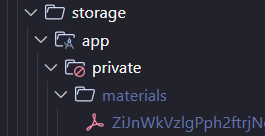
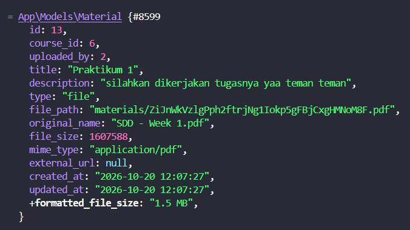
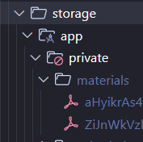
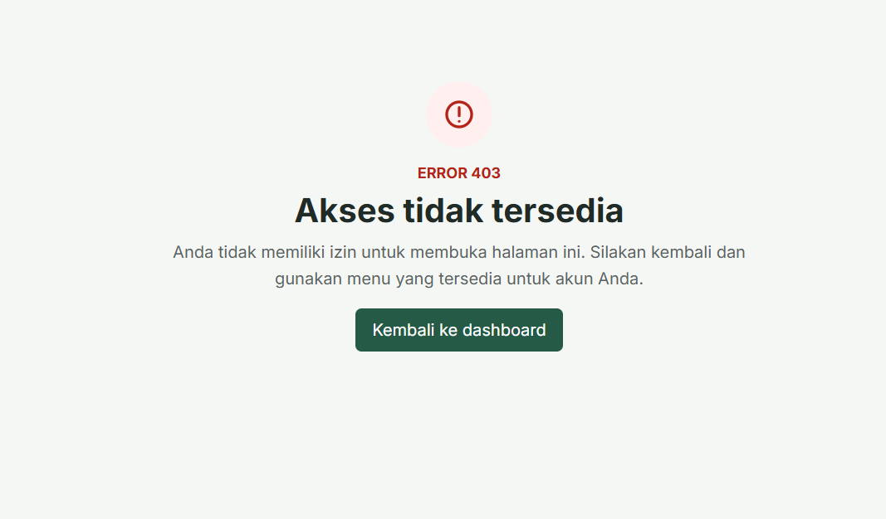
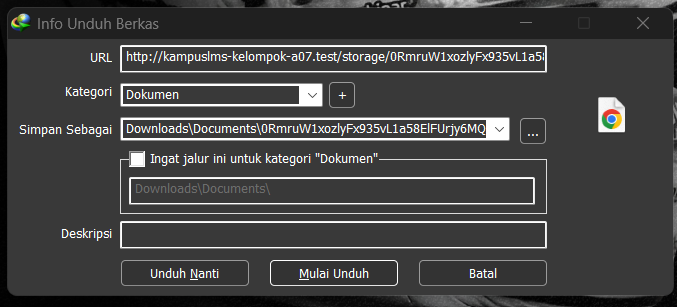
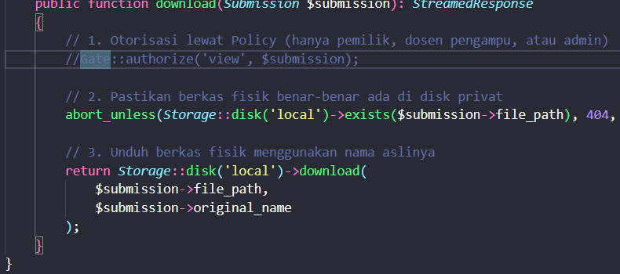
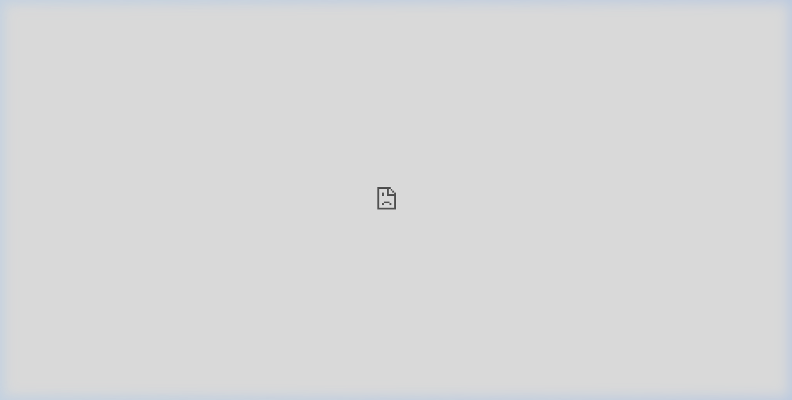

# Catatan Individu Minggu - 09 - Patra Ananda (10241061)
## 9.1 Konsep Unggahan Berkas dan Data Dinamis


## 9.3 Read, Break, Fix, Build

### READ: Menelusuri Jejak Satu Berkas di Sistem (30 Menit)

**Unggah satu berkas materi, lalu tanpa AI:**

#### 1. Di mana lokasi fisik berkas tersebut tersimpan di harddisk?

**Jawab:**
``project\kampuslms-kelompok-A07\storage\app\private\materials\ZiJnWkVzlgPph2ftrjNg1Iokp5gFBjCxgHMNoM8F.pdf``

Folder Penyimpanan: Berkas masuk ke dalam storage/app/private/materials/ karena di 

MaterialController.php
 kode memanggil:
``$file->store('materials', 'local')``
Pada Laravel 12, disk 'local' secara default diarahkan ke folder privat (storage/app/private/).
Nama Berkas: Nama file aslinya tidak dipakai sebagai nama fisik di harddisk. Laravel otomatis mengacaknya menjadi string hash unik sepanjang 40 karakter (ZiJnWkVzlgPph2ftrjNg1Iokp5gFBjCxgHMNoM8F.pdf) untuk mencegah tumpang-tindih nama dan serangan manipulasi path (path traversal).

#### 2. Bandingkan path di database dengan lokasi fisik di harddisk

**Jawab:**
Path database : 
ketika dicek langsung ke database menggunakan php artisan tinker : 

``` 
php artisan tinker
> App\Models\Material::find(13)
```

yang terjadi adalah file yang terakhir di upload 


Path fisik :


Perbandingan antara keduanya: 
Database hanya menyimpan alamat relatif (materials/...) tanpa awalan folder komputer (storage/app/private/ atau C:\Users\...).

Alasannya sengaja dibuat seperti ini agar data database bersifat fleksibel: jika proyek dipindahkan ke server lain dengan struktur folder berbeda, path di database tetap valid dan berkas tetap bisa ditemukan oleh Laravel.

#### 3. Coba akses berkas langsung lewat URL browser

**Jawab**

URL yang dicoba : 

```
http://kampuslms-kelompok-a07.test/storage/materials/ZiJnWkVzlgPph2ftrjNg1Iokp5gFBjCxgHMNoM8F.pdf
```


hasil yang diberikan adalah muncul tampilan error ``403 forbidden`` kenapa error karena server blokir akses langsung ke folder penyimpanan yang sifatnya private, berkas di ``storage/app/private`` tidak memiliki izin publik dan wajib diakses melalui controller yang sudah di daftarkan lewat login dan polic. 

#### 4. Apa beda disk `local` dan `public` di `config/filesystems.php`?

**Jawab**
Perbedaan utamanya terletak pada **lokasi penyimpanan default** serta **izin akses**:

1. **`public` (Disk Publik)**
   - **Lokasi:** Berkas disimpan di `public/storage`.  
   - **Akses:** Dapat diakses langsung melalui URL browser (misalnya: `.../storage/file.jpg`).  
   - **Tujuan:** Cocok untuk berkas yang memang dimaksudkan untuk dilihat publik, seperti gambar profil, logo, atau dokumen yang perlu diakses siapa saja.

2. **`local` (Disk Lokal/Privat)**
   - **Lokasi:** Berkas disimpan di `storage/app`. (Dalam konfigurasi default Laravel 12, seringkali diarahkan ke subfolder tersembunyi seperti `storage/app/private`).
   - **Akses:** **TIDAK BISA** diakses langsung via URL browser. Akses harus melewati Controller atau Route khusus yang sudah diautentikasi (Login).
   - **Tujuan:** Cocok untuk data sensitif, dokumen internal, materi yang tidak semuanya bisa buka lewat URL, atau berkas yang aksesnya perlu dikontrol ketat.

#### 5. Apa fungsi perintah `php artisan storage:link`?

**Jawab**

Perintah `php artisan storage:link` berfungsi untuk membuat jalan pintas (*symbolic link*) dari folder luar `public/storage` yang terhubung langsung ke folder dalam `storage/app/public`.

Dengan jalan pintas ini, web server bisa memberikan akses ke publik untuk mengambil berkas (seperti foto profil atau logo kampus) langsung ke browser lewat URL `/storage/...`.

**Kenapa materi kuliah tidak boleh ada di sana?**  
Karena semua berkas di dalam `storage/app/public` bersifat terbuka untuk umum. Siapa pun yang tahu tautan URL-nya bisa langsung mengakses berkas tersebut tanpa perlu login dan tanpa dicek oleh `MaterialPolicy`. Materi kuliah adalah dokumen privat yang hanya boleh diakses oleh mahasiswa yang terdaftar di kelas tersebut, sehingga wajib disimpan di `storage/app/private`.

---

### BREAK: Menguji Delapan Skenario Kerusakan (50 Menit)

#### 1. Pindahkan berkas submission ke storage/app/public, akses URL-nya tanpa login

**Jawab**

Langkah yang dilakukan adalah memindahkan berkas tugas mahasiswa `0RmruW1xozlyFx935vL1a58ElFUrjy6MQARXzMnu.pdf` dari folder privat `storage/app/private/submissions/1/` ke folder publik `storage/app/public/`.

URL yang dicoba akses langsung di browser:
```
http://kampuslms-kelompok-a07.test/storage/0RmruW1xozlyFx935vL1a58ElFUrjy6MQARXzMnu.pdf
```


Hasil yang diamati di layar:
Berkas PDF tugas mahasiswa langsung otomatis terunduh tanpa ada verifikasi login karena folder `public/storage` bisa diakses langsung oleh web server sebagai berkas statis tanpa melewati rute aplikasi `routes/web.php` dan tanpa memicu otorisasi Policy. 

Selain itu, jika diakses melalui controller resmi (`app/Http/Controllers/SubmissionController.php`), method `Storage::download()` sengaja mengirimkan header HTTP `Content-Disposition: attachment` yang memerintahkan browser untuk langsung mengunduh berkas fisik ke komputer.

#### 2. Hapus `Gate::authorize()` dari endpoint download, akses submission orang lain

**Jawab**

Langkah yang dicoba:  
Membuka berkas `app/Http/Controllers/SubmissionController.php`, lalu menonaktifkan baris `Gate::authorize` pada method `download()`:




Setelah itu, login sebagai mahasiswa (`mahasiswa@kampuslms.test`), lalu mengakses URL unduhan berkas tugas milik mahasiswa lain dengan mengganti nomor ID di browser:
```
http://kampuslms-kelompok-a07.test/submissions/2/download
```


ini hasilnya salah. 

Hasil yang diamati di layar:  
Karena baris `Gate::authorize` dinonaktifkan, berkas tugas milik mahasiswa lain langsung terbuka dan terbaca utuh di peramban tanpa dicegat oleh sistem.

Bahaya keamanannya:  
Ini adalah celah IDOR (Insecure Direct Object Reference) pada berkas. Pengguna biasa bisa menyedot seluruh dokumen tugas milik teman sekelasnya hanya dengan mengganti parameter angka ID di URL browser (`/submissions/1/download`, `/submissions/2/download`, dan seterusnya).

Oleh karena itu, menyembunyikan tombol unduh di antarmuka Blade dengan `@can` tidak cukup menjamin keamanan. Otorisasi wajib selalu ditegakkan di sisi server menggunakan `Gate::authorize('view', $submission)`.

#### Pelajaran Paling Kritis dari Eksperimen Break:

Poin **Nomor 1 dan 2** membuktikan hal yang paling penting:  
Banyak orang mengira jika tombol "Unduh" sudah disembunyikan dari layar mahasiswa lain, aplikasi sudah aman. Itu salah besar. Pengguna yang paham sedikit teknis bisa langsung menebak tautan berkas atau menembak URL download melalui Postman atau cURL. Keamanan berkas wajib dijaga di sisi server dengan menaruh berkas di folder privat dan memanggil `Gate::authorize()` sebelum berkas dikirimkan.

---

